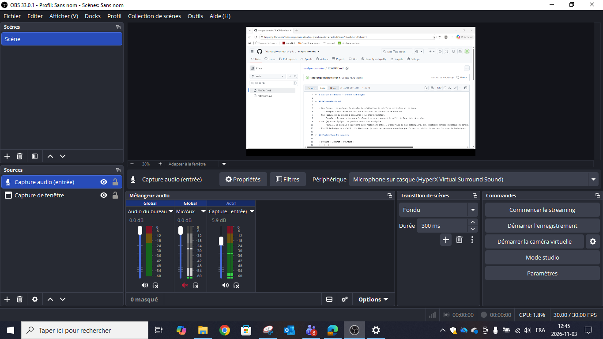

# analyse-domaine
Tp1 - diffusion

# Analyse du domaine — Simon Paquin

## Découverte de soi

- Mes forces : Attention au détail
    - Exemple : Je laisse rarement une erreur facile à voir dans mes travaux et met des efforts dans les petits détails
- Mes faiblesses ou points à améliorer : Ponctualité
    - Exemple : Moins de retard et faire le projet plus en avance
- Seul(e) ou en équipe : Seul
    - Pourquoi et exemple : Difficulté à arranger pour recevoir les choses à temps
- Plutôt technique ou créatif : Créatif

## Exploration des domaines

| Domaine | Intérêt | Pourquoi |
|---|---|---|
| Graphisme | bas | j'ai besoin d'un style général pour le marketing de mon jeux mais rien de profond |
| Vidéo et animation 2D | moyen | faire des vidéos youtube aide à faire de la pub pour les jeux indy |
| 3D | haut | Je veux faire du indy faique il faut que je fasse mes modèles moi même |
| Web | bas | pas de correlation avec ce que je veux faire beaucoup |
| Jeux vidéo | fort | C'est ce que je veux faire comme job |
| Développement logiciel | bas | je n'ai pas encore beaucoup d'expérience avec ça mais je pense que ca va pas trop m'intéresser |
| Installations et expériences immersives | moyen | Je pense je vais pouvoir utiliser beaucoup de créativité |

## Mes 2 domaines préférés

### Domaine 1 : ...

- Expérience : ...
- Logiciels et outils : ...
- Pourquoi il m'intéresse : ...
- Travailler dans ce domaine : ...

### Domaine 2 : ...

- Expérience : ...
- Logiciels et outils : ...
- Pourquoi il m'intéresse : ...
- Travailler dans ce domaine : ...

## Les caractéristiques de mon domaine préféré

- Types d'entreprises : ...
- Exemple d'entreprise : ...

(source de l'image : ...)

- Types de produits et de services : ...
- Étapes de production : ...
- Type d'emploi visé : ...
- Étapes pour obtenir cet emploi : ...

## Conclusion

- Mon profil en une phrase : ...
- Ce qui m'a surpris : ...
- Ma force principale et la faiblesse à travailler : ...
- Mon action d'ici la fin de la session : ...

## Ma capsule

